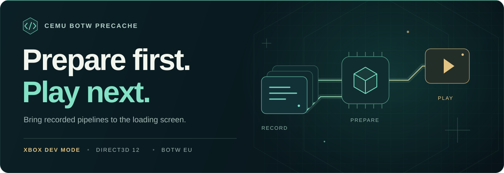
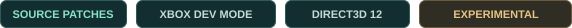

<!-- coderabbit-ai-generated:v1 -->

<!-- coderabbit-ai-generated-section:v1:a0eac20901fddc6613d3d00a47b47fe67d505c3156b3602ffa26c3276c50b500 -->

<p align="center">
  
</p>

<h1 align="center">Cemu BOTW Precache</h1>

<p align="center">
  Bring recorded Breath of the Wild pipelines to the loading screen.<br />
  An independent patch set for Cemu-UWP on Xbox Dev Mode.
</p>

<p align="center">
  
</p>

<p align="center">
  <a href="#quick-start">Quick start</a> &nbsp; · &nbsp;
  <a href="docs/BUILD.md">Build guide</a> &nbsp; · &nbsp;
  <a href="#the-patch-set">The patches</a> &nbsp; · &nbsp;
  <a href="#project-status">Project status</a>
</p>

---

## A little preparation before the adventure

Cemu compiles new shaders and graphics pipelines as it encounters them. This project moves **recorded BOTW pipeline work** into startup, using Cemu-UWP's existing D3D12 loading flow. It also gives the custom build its own Xbox package identity.

| Prepare before play | Keep your own app | Stay in control |
| :--- | :--- | :--- |
| Load all recorded pipelines for BOTW EU, including older entries normally skipped by the preload filter. | A separate package name, publisher, signing configuration and launch protocol, intended to coexist with PrismFox's build. | One opt-in setting overrides Quick start for BOTW. Turn it off to return to the general settings. |

> [!IMPORTANT]
> **Source patches — build on Windows before installing.** This repository does not contain a compiled Xbox app. Preloading requires existing shader and D3D12 pipeline caches; unseen effects can still need compilation.

## Quick start

### 01 · Build your package

Follow the **[build & setup guide](docs/BUILD.md#apply-and-build-the-patch)** to check out the pinned Cemu-UWP revision, apply both patches in order, and build a signed MSIX on Windows.

Already using the first patch? Apply only `0002` to add the separate package identity, then rebuild.

### 02 · Bring your recorded caches

Copy this pair into the new app's active `shaderCache/transferable` folder while Cemu is closed:

```text
00050000101c9400_shaders.bin
00050000101c9400_d3d12pipelines.bin
```

Collect them with the same fork's Windows D3D12 renderer or reuse your Xbox's existing records. [Cache preparation & locations →](docs/BUILD.md#supply-the-cache-input)

### 03 · Prepare, then play

In the patched launcher, enable **BOTW EU: preload all recorded pipelines before play**, then launch title `00050000101c9400`.

The option enables pipeline loading, overrides Quick start, and includes old recorded entries. Startup takes longer and uses more memory. [Enable & verify →](docs/BUILD.md#enable-and-verify)

## The patch set

Apply in the order shown. Both patches target Cemu-UWP's `d3d12-backend` revision [`522d349`](https://github.com/PrismFox67/Cemu-UWP/tree/522d3498b5a8b3854d01909950c3738de5c94aa2).

| Patch | What it adds |
| :--- | :--- |
| **[01 · BOTW full preload](patches/0001-botw-full-preload.patch)** | The launcher option, saved configuration, and selection of all recorded BOTW EU pipelines before gameplay. |
| **[02 · Independent Xbox package](patches/0002-independent-xbox-package.patch)** | Package identity, matching signing subjects, a distinct launch protocol, and a build script that preserves the customized manifest. |

<details>
<summary><strong>Your Xbox package at a glance</strong></summary>

| Field | Value |
| :--- | :--- |
| Tile name | **Cemu BOTW Precache** |
| Package identity | `Coolkool2233Pixel.CemuBOTWPrecache` |
| Publisher | `CN=Coolkool2233Pixel.CemuBOTWPrecache` |
| Protocol | `cemu-botw-precache:` |
| Local build output | `build-botw-precache-local/AppPackages` |

The new package has separate app storage. Copy any saves, keys, installed updates/DLC and caches you want to reuse. External folders are shared if you explicitly select the same locations for both apps.

[Full identity and installation details →](docs/BUILD.md#separate-xbox-installation)

</details>

## Project status

**Experimental.** The patch selection and package configuration are checked locally; Xbox deployment and performance still need device verification.

| Checked | Still needs verification |
| :--- | :--- |
| Both patches apply and reverse on the pinned source. | Complete Windows/UWP build and MSIX signing. |
| 48 title/settings combinations and native cache selection checks. | Simultaneous installation alongside PrismFox's app. |
| Package identity, signing-subject consistency and a temporary OpenSSL certificate. | BOTW gameplay, memory use and stutter reduction on Xbox. |

This prepares **known records**. It cannot generate every shader from a title ID, and Vulkan pipeline files cannot substitute for D3D12 records. Xbox may rebuild recorded pipelines on every launch. [How it works & limits →](docs/BUILD.md#what-is-possible)

### Run the local checks

With Python 3, Git, OpenSSL and a C++17 compiler:

```sh
python3 tests/check_patch.py /path/to/Cemu-UWP
```

The checks use pristine files from the pinned commit and temporary fixtures, leaving your source checkout untouched. [Validation details →](docs/BUILD.md#validation-included-here)

## Built on the work of

- **[PrismFox67 / Cemu-UWP](https://github.com/PrismFox67/Cemu-UWP)** — the UWP frontend and Direct3D 12 fork this patch set targets.
- **[The Cemu team](https://github.com/cemu-project/Cemu)** — the Wii U emulator at the foundation of the project.

The upstream credits are preserved in the patched app. No game files, cache databases or compiled app are bundled here. This project is not affiliated with Nintendo.

---

<p align="center">
  <strong>Record it once. Prepare it before play.</strong><br />
  <sub>Maintained by <a href="https://github.com/coolkool2233-pixel">coolkool2233-pixel</a> · BOTW EU <code>00050000101c9400</code></sub>
</p>


<!-- /coderabbit-ai-generated:v1 -->